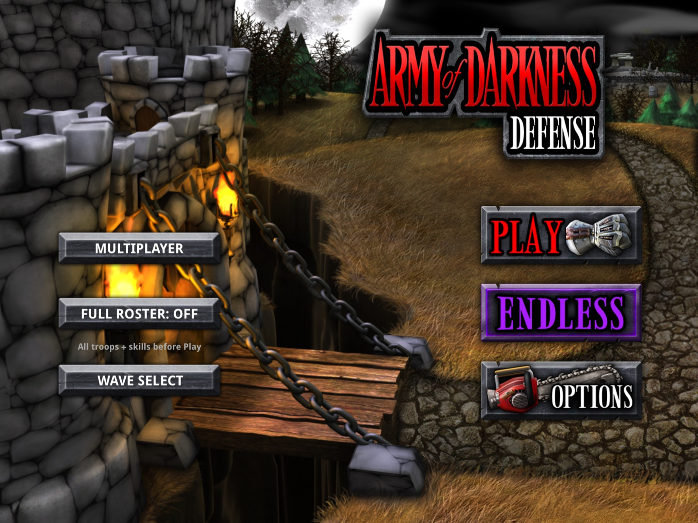
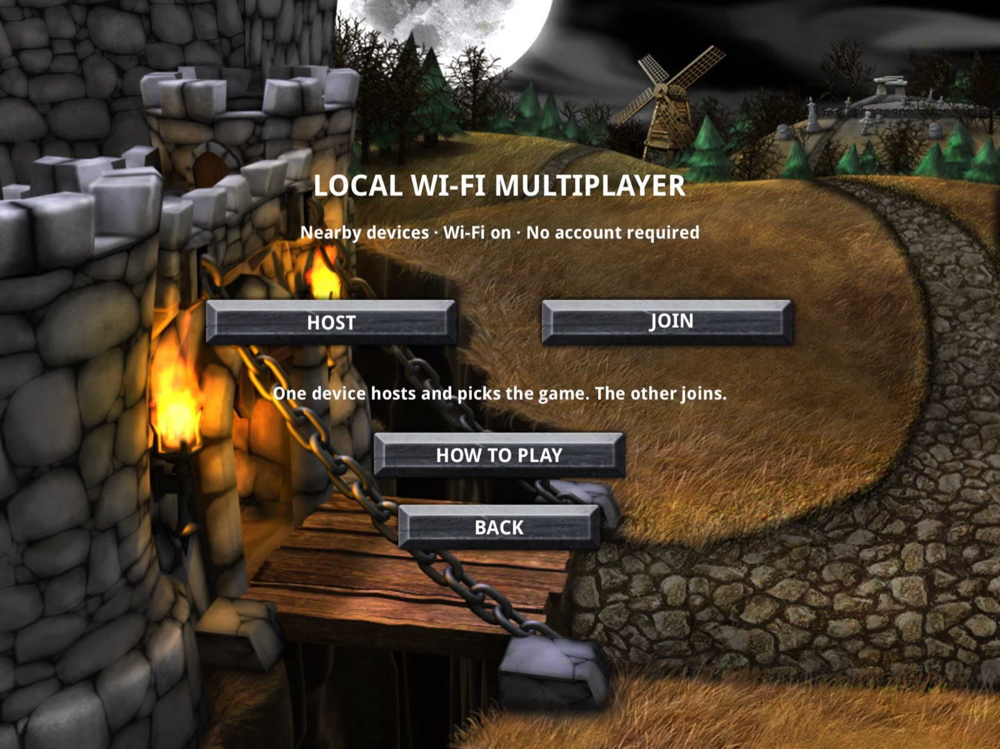
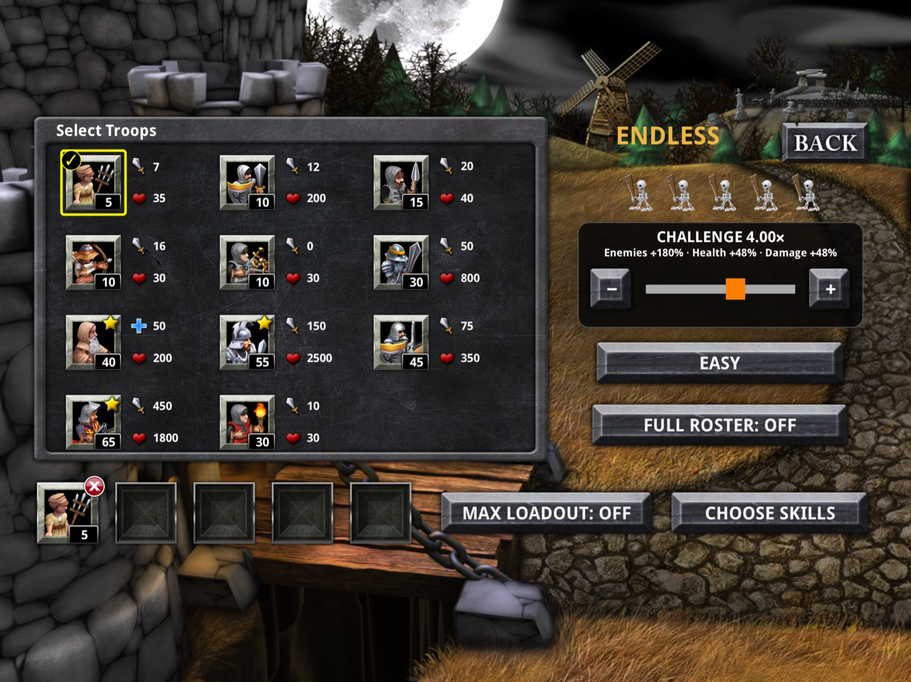
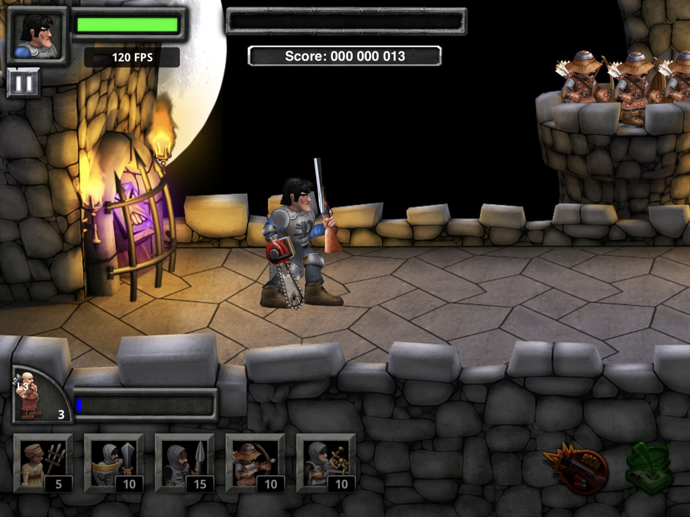
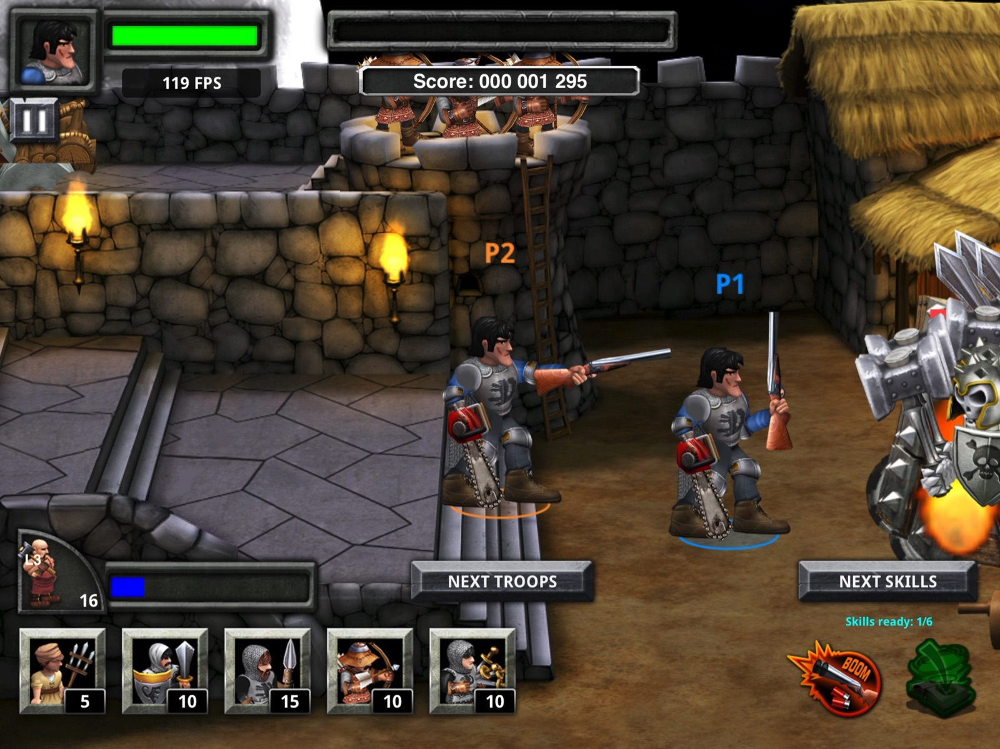
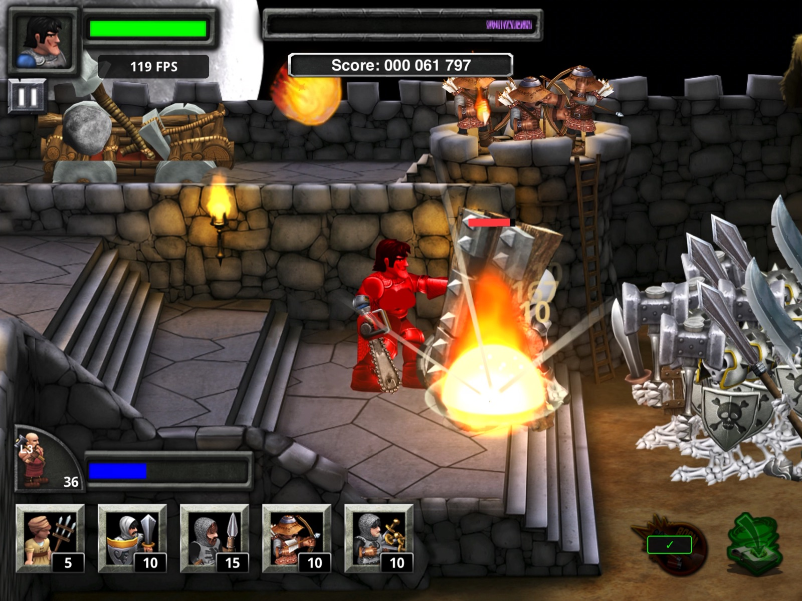

# Army of Darkness Defense — engineering showcase

Selected Swift implementation examples from a personal Swift/SpriteKit recreation project. This repository demonstrates performance work, multiplayer timing and packet handling, and the tests used to check correctness. It is a curated showcase, not the complete game or an installable distribution.

## Screenshots

Captured on an iPad Pro 12.9-inch from the project's own build.

<table>
<tr><td width="50%"> Home screen</td><td width="50%"> Local Wi-Fi multiplayer</td></tr>
<tr><td width="50%"> Troop select and challenge scaling</td><td width="50%"> Opening of a battle</td></tr>
<tr><td width="50%"> Co-op: host (P1) and guest (P2) heroes</td><td width="50%"> Late-wave fight at 119 FPS</td></tr>
</table>

## Code examples

| File | What it shows |
| --- | --- |
| [`code/performance/CombatTargetIndex.swift`](code/performance/CombatTargetIndex.swift) | A generic per-team spatial index over lane positions. It answers nearest, range, minimum, furthest and ordered-visit queries with the same results and tie order as a linear scan, and reuses its records and scratch buffers between frames. |
| [`code/performance/PerformancePrimitives.swift`](code/performance/PerformancePrimitives.swift) | A presentation budget shared across callbacks, cancellation, and bit-exact warp destination identity. The destination key avoids time quantization while sharing identical render geometry. |
| [`code/multiplayer/PresentationTiming.swift`](code/multiplayer/PresentationTiming.swift) | The guest's presentation clock, which interpolates 150 ms behind the host without rewinding, and the host's 20 Hz snapshot cadence, which skips missed deadlines instead of bursting. |
| [`code/multiplayer/OrderedPacketDecoder.swift`](code/multiplayer/OrderedPacketDecoder.swift) | An adapted standalone serial decoder with packet/byte limits, FIFO main-thread delivery and generation cancellation. |
| [`tests/ShowcaseTests.swift`](tests/ShowcaseTests.swift) | Seeded brute-force comparisons for the index, clock jitter and outage bounds, cadence, frame-budget, Float precision, queue-bound, ordered-delivery and stale-callback checks, all with synthetic data. |

Run `./scripts/test.sh` on macOS with Xcode command-line tools. Each check prints its name.

These examples build independently of the original game and its assets. See [architecture](docs/architecture.md), [measured results and limits](docs/performance.md), and [provenance](docs/provenance.md).

## Redistribution boundary

This repository contains selected implementation examples and technical documentation from a recreation project. It does not distribute the original game, extracted Lua or bytecode, recovered game data, or original game assets. Redistribution permission for those materials has not been established. Their availability elsewhere online does not grant permission to rehost them. Original game material remains the property of its respective rights holders; any license added here applies only to explicitly identified project-authored material. No blanket open-source license is granted by this repository.

The [archived original game listing](https://archive.org/details/aodhd-1.1.1-ipa) is linked for provenance only. No affiliation with or endorsement by the original developer or rights holders is claimed. The screenshots show this project running; the original game's logo, characters and artwork visible in them remain the property of their respective rights holders and are not licensed by this repository.

## Synchronization

The private project is the source of truth. A reviewed allowlist exports only these examples, tests and documents. `SYNC_MANIFEST.json` identifies the private source commit and exported file hashes. Exporting never commits or pushes, and public changes never automatically flow back to private. Read [the workflow](docs/sync.md).
